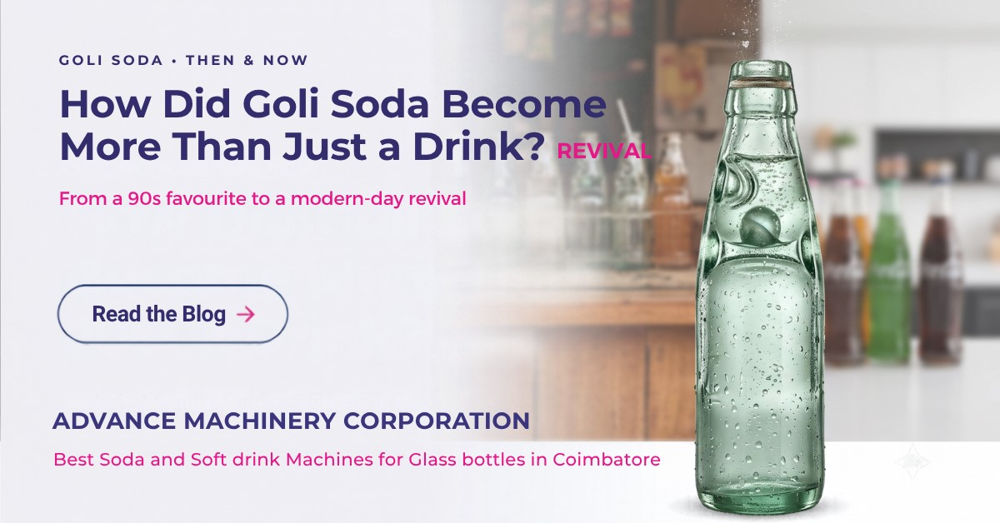

# Goli Soda: From Traditional Bottle to Modern Beverage
Goli Soda is a traditional Indian carbonated beverage recognised by its distinctive marble-sealed bottle.

## The Bottle That Made It Different
The traditional **Codd-neck bottle** uses a glass marble and internal seal to retain carbonation. The bottle design dates back to the 19th century.
## The Changing Beverage Market
Goli Soda became less visible as large soft-drink brands expanded their distribution and introduced modern packaging. Traditional glass bottles also required collection, cleaning and reuse.
## The Revival of Goli Soda
Modern Goli Soda brands are combining the traditional identity with:
- **Contemporary branding**
- **New flavour profiles**
- **Wider distribution**
- **Glass and alternative packaging formats**

Traditional flavours such as Paneer Soda continue to exist alongside newer concepts such as blueberry and green apple.
## Modern Carbonated Beverage Production
Modern carbonated beverage production can involve:

**Water Treatment → Chilling → Carbonation → Bottle Rinsing → Filling → Capping**

The equipment required depends on the beverage, bottle type and production capacity.

**Read the full article:**

[How Did Goli Soda Become More Than Just a Drink?](https://advancemachineryindia.com/how-did-goli-soda-make-a-comeback/)
